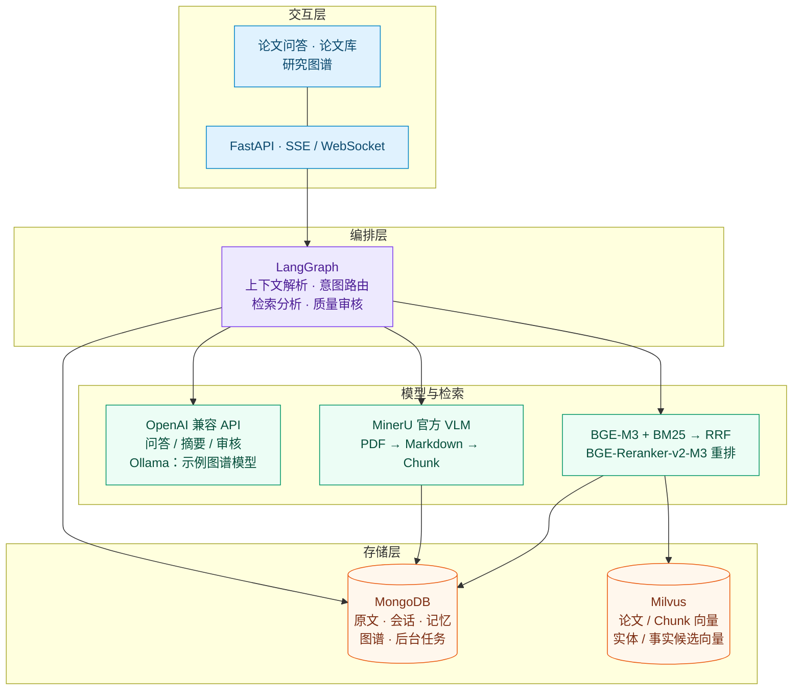
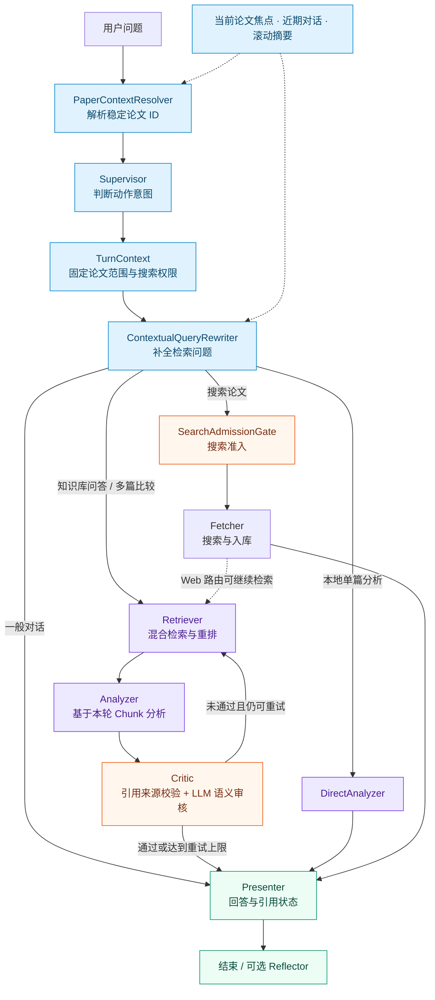
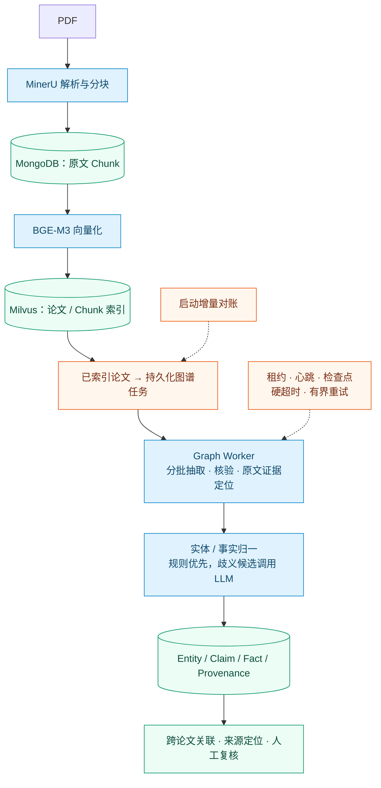

# Paper Agent

Paper Agent 是一个论文阅读与知识整理工具，支持论文搜索、多轮问答和跨论文比较。系统利用检索到的原文片段辅助分析，校验回答中的引用来源，并将抽取的论文主张及其出处保存到研究图谱。


[English](README.en.md) · [技术架构](docs/architecture.md)

## 项目背景

阅读论文时，经常需要围绕同一篇文章连续追问、比较不同论文的结论，并回到原文核对。项目主要处理这些过程中遇到的几个问题：

| 工程问题 | Paper Agent 的设计 |
| --- | --- |
| “它的实验怎么做？”容易丢失论文焦点，甚至被当成新的搜索词 | 用稳定论文 ID 管理焦点，分离身份解析、意图路由与检索问题改写 |
| 回答可能引用本轮没有检索到的论文 | 将事实生成约束到当前证据，先校验引用来源，再做 LLM 语义审核 |
| 零散 Chunk 难以表达跨论文主张及其出处 | 用 Entity / Claim / Fact / Provenance 保留关联、原文定位和审核状态 |
| 解析或图谱任务中断后难以定位、恢复 | 持久化任务状态，配合租约、检查点、失败诊断与页面执行时间线 |

## 技术架构

各层围绕论文问答和知识整理分工：FastAPI 提供交互入口，LangGraph 管理执行状态，检索与图谱共享论文数据。



运行环境：Python 3.10+；本地向量模型使用 PyTorch，MongoDB、Milvus 及检索配套服务由 Docker Compose 管理。

## 问答流程

先确定论文，再判断用户要做什么。历史对话只用于补全问题；引用依据来自本轮检索的原文。



各节点分别记录执行状态与耗时。Critic 重试回到检索阶段，复用已解析的论文范围和检索问题；达到重试上限只表示结束修订，不代表回答已通过事实核验。

## 关键设计

### 1. 保持当前论文焦点

仅靠聊天记录判断“它”指向哪篇论文，容易混淆讨论对象，也可能把历史回答误当成论文事实。[PaperContextResolver](core/paper_context.py) 优先解析显式目标与稳定论文 ID，再使用唯一会话焦点；存在歧义时不从助手文本猜标题。

`TurnContext` 将论文范围、当前动作和外部搜索权限传给下游。Supervisor 只判断动作意图，`SearchAdmissionGate` 只对明确的搜索意图放行，避免将“它的实验怎么做？”直接交给 arXiv。

### 2. 补全省略式追问

“第二个贡献呢？”缺少可独立检索的语义。[ContextualQueryRewriter](core/contextual_query.py) 结合已解析论文、活动章节与任务、限定长度的近期对话和滚动摘要，生成 `retrieval_query`；近期助手回答只帮助定位“第二点”“刚才第三点”等追问对象。

改写器不改变论文 ID 或搜索权限，历史上下文不进入 `retrieved_chunks`。每轮最多调用一次 LLM，Critic 重试复用结果；没有可用上下文或改写失败时回退到原始问题。

### 3. 约束回答的证据来源

Retriever 提供本轮 `retrieved_chunks`，Analyzer 被要求仅据此组织论文事实。Critic 在 LLM 语义审核之前执行[确定性引用校验](core/evidence.py)：**回答引用的论文必须来自当前检索结果**，同时检查无证据时是否明确拒答。

规则未通过时会在重试次数限制内重新检索。证据面板显示原文来源和校验状态；LLM 继续检查回答内容是否有依据，用户可以沿引用回看原文。来源校验、语义审核和人工复核各自保留，不能互相替代。

### 4. 图谱构建与中断恢复

Chunk 检索提供局部文本；研究图谱进一步记录“哪篇论文提出什么主张、涉及哪些实体、证据位于哪里、关系是否经过审核”。Entity 统一实体与别名，Claim 保留论文主张，Fact 聚合跨论文主张，Provenance 保存 paper、chunk、section/page、原文证据及版本。



构建由后台 Worker 分批执行，使用持久化任务、租约与心跳、硬超时、检查点和有界重试处理失败及重启恢复。启动时增量对账已索引论文与图谱版本；配额耗尽单独标记，页面提供失败状态、手动重试和关系复核。图谱辅助关联与导航，最终回答仍回到当前检索的原文证据。

## 评测

[离线评测脚本](scripts/evaluate.py) 使用本地已入库论文和人工标注的问题集，统计以下指标。目前仓库尚未提交实测结果。

| 指标 | 当前统计口径 |
| --- | --- |
| Recall@5 | 期望论文在前 5 篇去重检索论文中的覆盖率，对用例取均值 |
| Citation Pass Rate | 证据规则通过的用例占比，包含无证据时正确拒答；不是事实准确率 |
| Abstention Accuracy | 应拒答用例中，同时无检索论文且证据规则通过的比例 |
| P50 Latency | 工作流端到端耗时中位数 |

```powershell
Copy-Item evaluation/cases.example.json evaluation/cases.local.json
# 按已入库论文填写 expected_papers，并标注 should_abstain
python scripts/evaluate.py --cases evaluation/cases.local.json
```

指标边界与测试命令见[评测操作说明](docs/operations.md#评测与测试)，计算实现见 [evaluation/metrics.py](evaluation/metrics.py)。比较结果时需固定论文库、标注集与模型配置。

## 快速开始

准备 Python 3.10+、Docker Desktop、LLM 服务凭据和 MinerU 官方 Token。以下按示例配置使用本机 Ollama 图谱模型；Ollama 服务需保持运行，本地 Embedding 需兼容 CPU / CUDA 的 PyTorch。

在仓库根目录执行：

```powershell
python -m venv .venv
.\.venv\Scripts\Activate.ps1
Copy-Item .env.example .env
# 编辑 .env：填写 LLM_API_KEY、MINERU_OFFICIAL_TOKEN，核对模型和服务地址
python -m pip install -r requirements.txt
ollama pull qwen3:8b
ollama create qwen3-graph:8b -f Modelfile
docker compose --env-file .env up -d
python -m uvicorn web.app:app --host 127.0.0.1 --port 8000
```

打开 [对话页面](http://localhost:8000) 或 [研究图谱](http://localhost:8000/graph)。配置与解析细节见[部署说明](docs/operations.md)。

## 使用边界

- **引用来源正确，不代表结论正确**：论文出现在检索结果中，不意味着回答中的每条断言都有原文支持。
- Critic 的 LLM 审核调用失败时默认放行，达到重试上限也会结束修订。因此，流程完成并不代表回答已经通过事实核验。
- 写作引用前仍需回看原文，核对实验配置、数字和因果结论。证据面板用于辅助核查，不能替代作者的判断。
